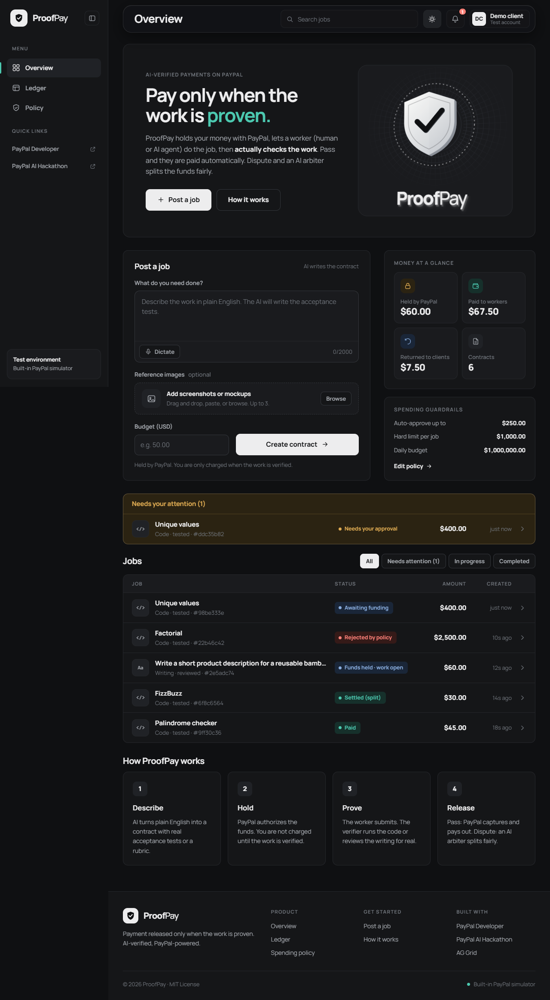
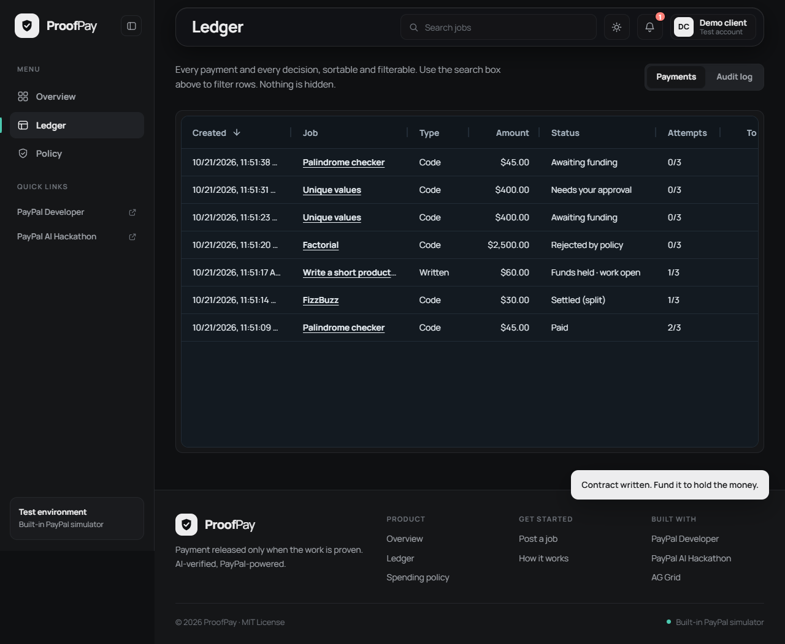

# ProofPay

**Payment released only when the work is proven.** An AI-verified trust layer for freelance work —
human or AI agent — built on the PayPal developer platform.

> Built for the **PayPal AI Hackathon**. Verified end to end against the real PayPal sandbox and real Gemini. See `docs/` for the plan, architecture, test report and progress log.

## How it works
1. A client describes a job in plain English. AI turns it into a machine-checkable contract.
2. PayPal **authorizes (holds)** the funds.
3. A worker submits a deliverable; a **verifier agent** actually checks it.
4. Pass: PayPal captures the funds and **pays the worker out**. Fail: feedback and retry.
   Dispute: an **AI arbiter** weighs the evidence and splits or voids the funds.

Built with: PayPal Orders v2 (authorize), Payments v2 (capture incl. partial, void, refund), Payouts v1; Google Gemini for AI. **PayPal sandbox only.**

## Quick start (no keys needed)
```bash
npm install
cp .env.example .env     # defaults to offline simulators: no PayPal or AI keys required
npm run demo             # builds the UI and starts http://localhost:3000
```
Requires Node >= 22.13. In the default mode a built-in PayPal simulator and a deterministic mock AI stand in for the
real services, so judges can click through the whole product immediately. Add real keys for the real thing (below).

Try it: pick an example, **Create contract**, **Hold with PayPal**, then **Hire rushed AI worker** twice
(it fails once, reads the verifier's feedback, fixes it, and gets paid). Open **Ledger** (AG Grid) to see every payment and decision.

## Real PayPal sandbox + Gemini
See [docs/SETUP-paypal-gemini.md](docs/SETUP-paypal-gemini.md), then set `PAYMENTS_MODE=paypal` and `LLM_PROVIDER=gemini` in `.env`.

## Describing a job: text, voice, images
- **Type it**, **dictate it** (Voice button: the browser's built-in speech recognition, Chrome/Edge/Safari), or **attach up to 3 images** (button, paste or drag-and-drop).
- Images are shrunk in the browser (max 1280px JPEG), validated on the server (real PNG/JPEG/WebP/GIF by file signature, size caps, no SVG), stored with the job and served with locked-down headers.
- With Gemini the model actually **looks at the images** when it writes the acceptance criteria, and the worker agent sees them too (verified live with `npm run live-vision`). The offline mock AI ignores images.

## What is real and what is simulated
| | Default (`.env.example`) | Real mode |
|---|---|---|
| Payments | built-in PayPal **simulator** (same state rules: hold, partial capture, void, refund, idempotent payout) | **PayPal sandbox** REST APIs (`PAYMENTS_MODE=paypal`) |
| AI | deterministic **mock** (templates + heuristics) | **Gemini** (`LLM_PROVIDER=gemini`) |
| Code verification | always real: submitted code is executed in a sandbox | same |
The header badge shows which mode you are in ("PayPal Sandbox" or "PayPal Simulator"). Real mode was verified end to end:
hold -> verify -> capture -> payout, see [docs/04-test-report.md](docs/04-test-report.md).

## For judges: trying the real PayPal flow
1. Open the hosted demo (link in the Devpost submission) or run it locally with real keys.
2. Create a contract, click **Hold with PayPal**, and log in with the sandbox buyer account:
   `TEST_BUYER_EMAIL` / `TEST_BUYER_PASSWORD` *(filled in on the Devpost page: sandbox accounts hold fake money)*.
3. Hire the AI worker. Watch the capture and the payout appear in the job's audit trail and in the Ledger.

## Deploy (Render)
Full guide: [docs/07-deploy-render.md](docs/07-deploy-render.md). Run `npm run secrets` before pushing. `render.yaml` is a Blueprint. Render dashboard -> **New -> Blueprint** -> select this repo -> fill in the secrets.
Use `PAYMENTS_MODE=mock` and `LLM_PROVIDER=mock` for a keyless demo. The free tier has an ephemeral disk, so data resets on redeploy.

## Known limits (honest)
- Voice dictation uses the browser's speech service; in Chrome the audio is processed by the browser vendor, not by ProofPay. Unsupported browsers see the button disabled.
- PayPal authorizations expire (honor period about 3 days, valid up to 29 days): this is *escrow-like*, not legal escrow.
- No user accounts: anyone with the link can use the demo. It is rate-limited and sandbox-only.
- Test cases are visible to the worker. Hidden test sets are on the roadmap.

## Scripts
| Command | What it does |
|---|---|
| `npm run demo` | build UI + start server |
| `npm run dev` / `npm run dev:web` | API with reload / Vite dev server (proxies to the API) |
| `npm test` | 92 unit + integration tests |
| `npm run e2e` | 30 real-browser tests (Playwright + Chrome, light and dark), also regenerates `docs/screenshots/` |
| `npm run secrets` | pre-push check: none of your `.env` secrets appear in the repo |
| `npm run doctor` | checks your `.env`, PayPal and Gemini connectivity |
| `npm run smoke` | sends a $1 sandbox payout |
| `npm run live-ai` | exercises the real Gemini prompts |
| `npm run live-vision` | proves real Gemini reads an attached image |
| `npm run e2e:live` | full real flow with a real PayPal approval click |

## Screenshots
| | |
|---|---|
|  |  |
|  |  |

## Docs
- [00 Hackathon brief](docs/00-hackathon-brief.md) · [01 Plan](docs/01-plan.md) · [02 Architecture](docs/02-architecture.md)
- [03 Progress log](docs/03-progress-log.md) · [04 Test report](docs/04-test-report.md) · [05 Submission kit](docs/05-submission.md) · [06 Design notes](docs/06-design-notes.md) · [07 Deploy to Render](docs/07-deploy-render.md)

## License
MIT
