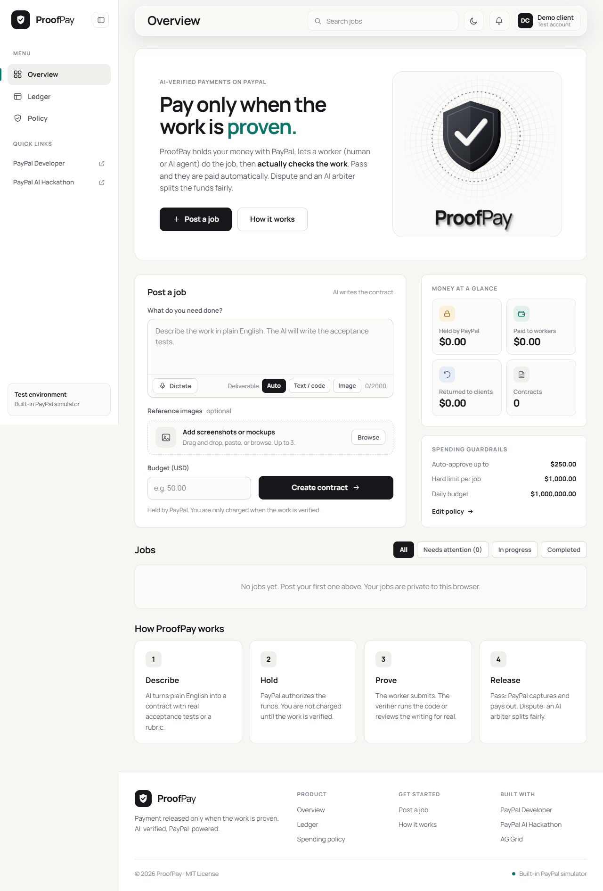
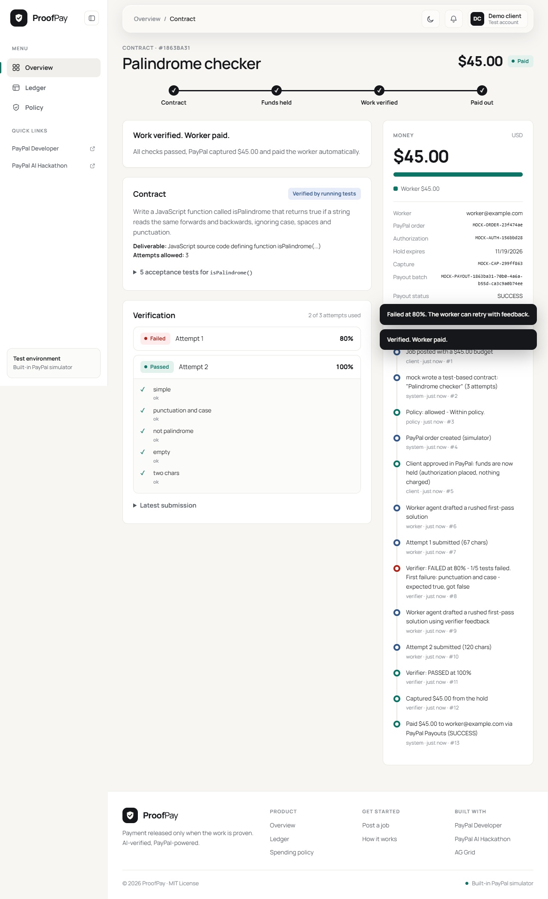

# ProofPay

**Payment released only when the work is proven.** An AI-verified trust layer for freelance work —
human or AI agent — built on the PayPal developer platform.

> Status: under active development for the PayPal AI Hackathon. See `docs/` for plan, architecture and progress.

## How it works
1. A client describes a job in plain English. AI turns it into a machine-checkable contract.
2. PayPal **authorizes (holds)** the funds.
3. A worker submits a deliverable; a **verifier agent** actually checks it.
4. Pass: PayPal captures the funds and **pays the worker out**. Fail: feedback and retry.
   Dispute: an **AI arbiter** weighs the evidence and splits or voids the funds.

Built with: PayPal Orders v2 (authorize/capture/void), Payments (refunds), Payouts, Webhooks; Google Gemini for AI.
Sandbox only.

## Quick start (no keys needed)
```bash
npm install
cp .env.example .env     # defaults to offline simulators: no PayPal or AI keys required
npm run demo             # builds the UI and starts http://localhost:3000
```
Requires Node >= 22.13. In the default mode a built-in PayPal simulator and a deterministic mock AI stand in for the
real services, so judges can click through the whole product immediately. Add real keys for the real thing (below).

Try it: pick an example, **Create contract**, **Hold with PayPal**, then **Hire rushed AI worker** twice
(it fails once, reads the verifier's feedback, fixes it, and gets paid). Open **Ledger** (AG Grid) to see every payment and decision.

## Real PayPal sandbox + Gemini
See [docs/SETUP-paypal-gemini.md](docs/SETUP-paypal-gemini.md), then set `PAYMENTS_MODE=paypal` and `LLM_PROVIDER=gemini` in `.env`.

## Scripts
| Command | What it does |
|---|---|
| `npm run demo` | build UI + start server |
| `npm run dev` / `npm run dev:web` | API with reload / Vite dev server (proxies to the API) |
| `npm test` | 72 unit + integration tests |
| `npm run e2e` | 8 real-browser tests (Playwright + Chrome), also regenerates `docs/screenshots/` |
| `npm run doctor` | checks your `.env`, PayPal and Gemini connectivity |
| `npm run smoke` | sends a $1 sandbox payout |
| `npm run live-ai` | exercises the real Gemini prompts |
| `npm run e2e:live` | full real flow with a real PayPal approval click |

## Screenshots
| | |
|---|---|
|  |  |
|  |  |

## Docs
- [00 Hackathon brief](docs/00-hackathon-brief.md) · [01 Plan](docs/01-plan.md) · [02 Architecture](docs/02-architecture.md)
- [03 Progress log](docs/03-progress-log.md) · [04 Test report](docs/04-test-report.md)

## License
MIT
